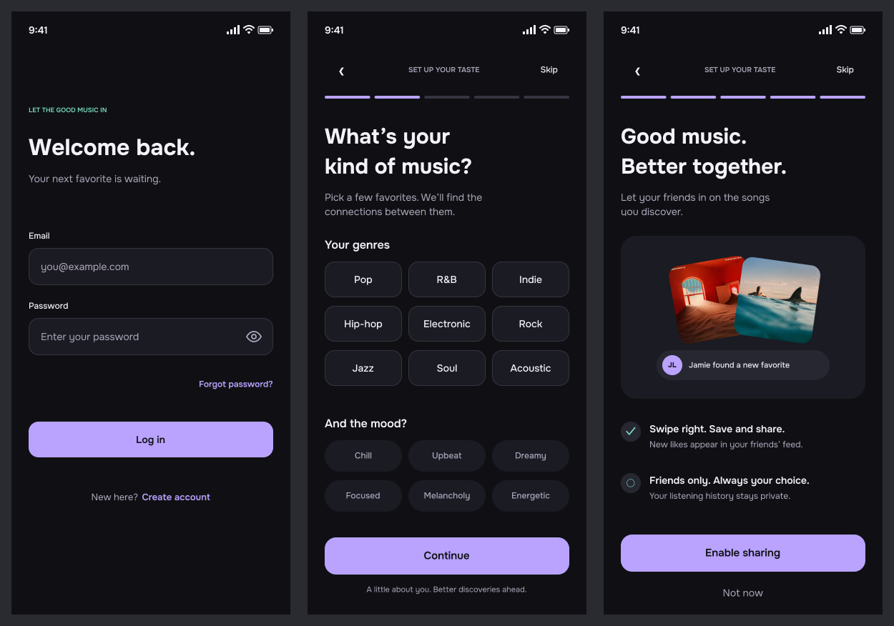
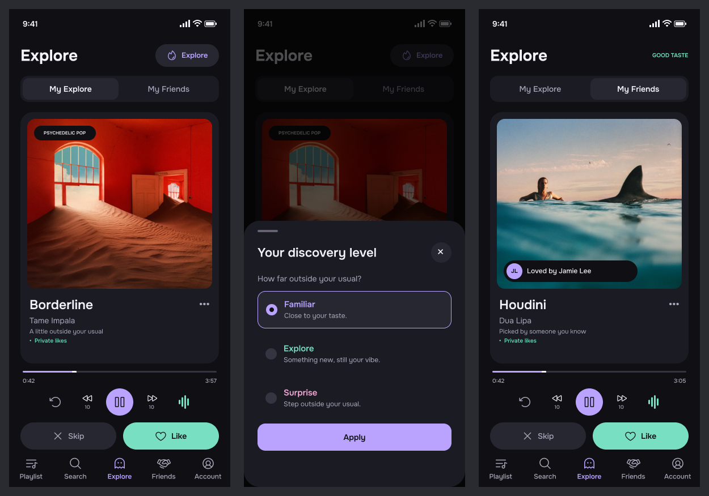
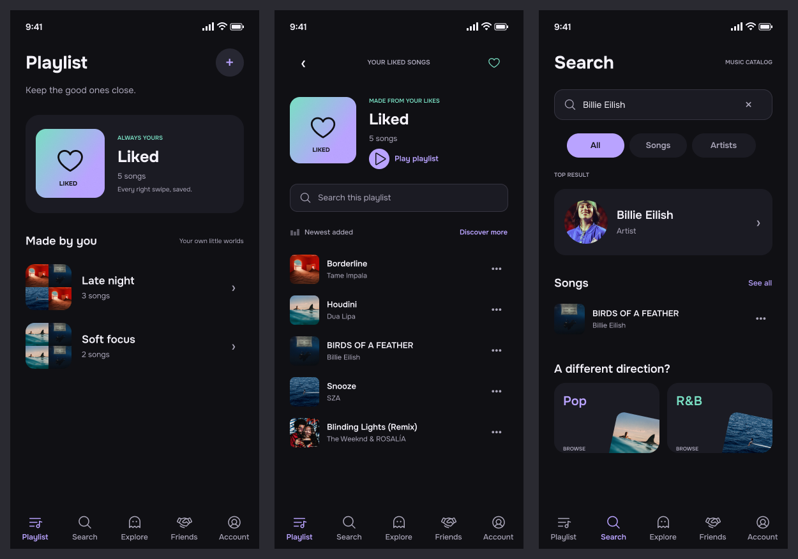
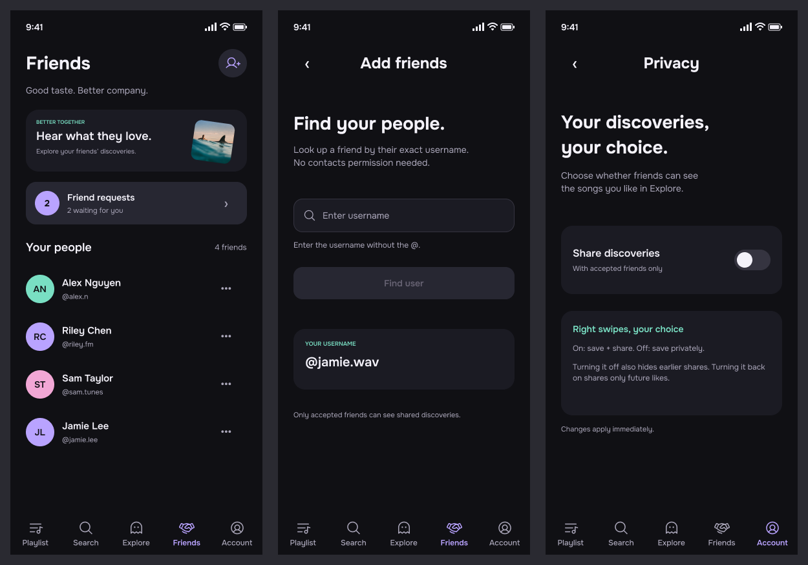
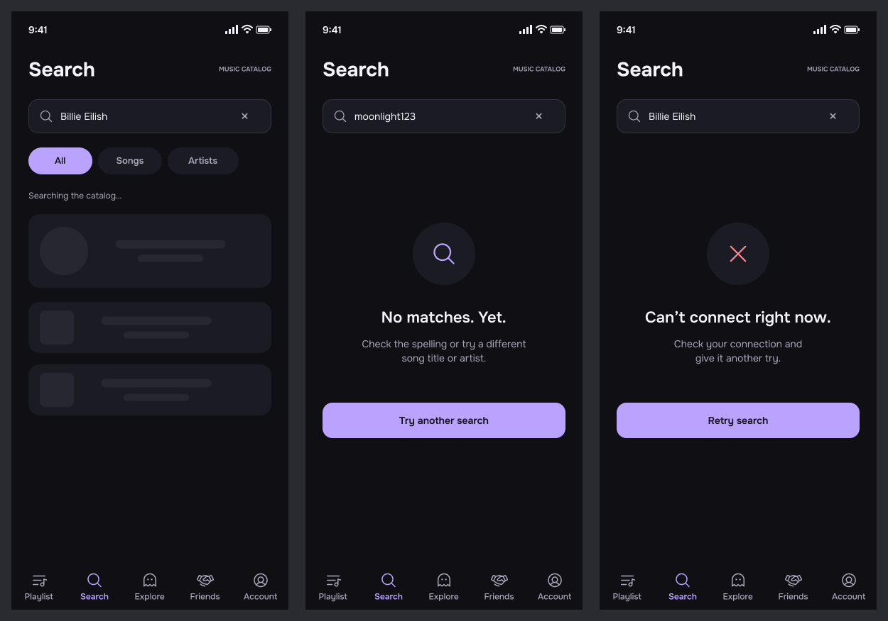

# Muser — Assignment 1 Report

Nov 24, 2026 · @Khang

## 1. Problem analysis and requirements elicitation

Muser helps young listeners find new songs quickly, through a swipe deck and the songs their friends like. Streaming apps hold millions of tracks but give users few ways to choose how familiar a recommendation should be. Sharing a song with a friend also means leaving the app for a chat.

### 1.1 Problem statement

- **Choice overload.** Listeners open a large catalog and fall back to the same playlists. They have no simple control over how adventurous the next song should be.
- **Discovery is slow.** Judging a song means searching, opening it and listening. There is no one-gesture keep or skip.
- **Friends' taste is hidden.** Music sharing happens in chat apps as links, outside the player, with no lightweight reaction.
- **Privacy is all or nothing.** Social features in music apps often expose listening history. Users want to share some discoveries and later hide them.

Muser's answer: a swipe deck of quick one-gesture decisions, a three-level **Familiar Bar** (Familiar, Explore, Surprise), friend sharing built into every like, a one-tap heart reaction, and an epoch-based privacy switch that hides past shares at once.

### 1.2 Scope

MVP: a curated catalog of 50 to 100 cleared tracks, built and demoed end to end. Out of scope: trained ML recommenders, licensing and DRM, offline downloads, chat and comments, user audio uploads, payments, ads and push notifications.

### 1.3 Stakeholders

| Stakeholder | Interest | Influence on requirements |
| --- | --- | --- |
| Listener (end user) | Find songs they like with little effort; save and organise them | Primary source of functional requirements |
| Friend of a listener | See and react to shared discoveries; control their own privacy | Drives sharing, reactions and privacy rules |
| Catalog administrator | Keep tracks, artists and tags valid and cleared | Seeder, catalog validation, admin-only writes |
| Rights holders of the demo tracks | Tracks used only as cleared | Small cleared catalog; no downloads |

### 1.4 Personas

**Linh, 20, university student (primary).** Listens 2 to 3 hours a day while studying and commuting. Bored of her own playlists but finds search tiring. Goal: two or three new songs a day without effort. Pain: recommendations feel either too safe or random. Muser features for her: swipe deck, Familiar Bar, Liked library.

**Minh, 22, social sharer.** Sends song links to friends in chat several times a week. Goal: show friends what he likes and see their reactions. Pain: links get buried in chat and reactions are lost. Muser features: My Friends deck, sharer attribution, heart reactions, Activity feed.

**An, 21, private listener.** Wants friends' recommendations but does not want every song she likes to be public. Goal: share only during chosen periods. Muser features: sharing off by default, privacy switch that hides all past shares, likes that stay private while sharing is off.

These personas are illustrative; their figures are examples, not measured data.

### 1.5 Research on the problem

Published surveys and studies support four needs behind Muser. They come from other platforms and age groups, so they back the problem rather than prove Muser works. Each finding below links to the requirements it shaped.

| Finding | Evidence | What it means for Muser | Requirements |
| --- | --- | --- | --- |
| Streaming apps and social media lead music discovery, friends and family follow | YouGov, online survey of adults 18+ in 17 markets (Nov 2021): music apps 36%, radio 33%, social media 32%, friends and family 27% | Discovery has to happen inside the music app. Friends are a real but secondary source, so the friends deck complements the personal deck | FR-EXP-01..03, FR-FRD-01 |
| Young adults lean most on social feeds and friends | Same survey, ages 18–24: social media 50%, friends and family 35%. YPulse (2019): 56% of 13–17-year-olds discover music through streaming suggestions, 55% through social media and 55% through YouTube | A fast, swipeable feed matches how the target group already finds music; a friend's pick adds a trusted signal | FR-EXP-01..03, FR-FRD-01..03 |
| Listeners differ in how much unfamiliar music they want | Moscati et al., UMAP 2025: Deezer listening data from 2022 combined with a user survey. Users who say they are more interested in unfamiliar music explore more music in the same time window, and they discover differently from other users. Streaming users in general tend to listen to familiar music more often | One fixed recommendation style cannot suit everyone, so the user sets how adventurous the next song is | FR-FAM-01, FR-FAM-02 |
| Choosing novel or familiar music depends on mood and risk, and listening logs alone can mislead | Kumar, Rubya, Konstan and Terveen, IntRS workshop 2018: a qualitative study naming boredom, need for attention and the risk of a bad selection as drivers. The authors warn that inferring needs from activity logs alone can misread users | Let people say what they want (Familiar, Explore, Surprise) instead of guessing, and make a skip free of consequences | FR-FAM-01, FR-EXP-02 |

**Limits of this evidence.** The two surveys describe discovery sources in general, not swipe apps. The YouGov data is from November 2021, and the YPulse article does not state its sample size. The Deezer study and the Minnesota study are about general listening. This research did not find a verified study on how comfortable people are sharing their liked songs, so the sharing switch (off by default, past shares hidden when turned off) is a design decision, not a cited finding.

**Sources:** [YouGov, How are global consumers finding new music? (Bruce, 4 Jan 2022)](https://yougov.com/articles/40255-how-are-global-consumers-finding-new-music) · [YPulse, How Gen Z and Millennials are discovering music on social media (1 Oct 2019)](https://www.ypulse.com/article/2019/10/01/how-gen-z-millennials-are-discovering-music-on-social-media-in-2-charts/) · [Moscati et al., Familiarizing with Music: Discovery Patterns for Different Music Discovery Needs, UMAP 2025](https://arxiv.org/abs/2505.03568) · [Kumar et al., Risk "attention" or "adventure": a qualitative study of novelty and familiarity in music listening, CEUR vol. 2225, 2018](https://experts.umn.edu/en/publications/risk-attention-or-adventure-a-qualitative-study-of-novelty-and-fa/)

### 1.6 Competitor analysis

| App | Discovery model | Social sharing | User control over novelty | What Muser adds |
| --- | --- | --- | --- | --- |
| Spotify | Algorithmic playlists (for example Discover Weekly), radio | Share links, collaborative playlists | Low: no direct familiar/new dial | One-gesture decisions and a novelty dial |
| Apple Music | Editorial and personal mixes | Friend profiles showing listening | Low | Opt-in, revocable sharing |
| YouTube Music | Home feed and radio | Share links | Low | Focused music-only swipe flow |
| TikTok | Short-video swipe feed | Comments, shares | None explicit | Full songs saved to a library and playlists |
| Muser | Swipe deck of recommended songs, plus catalog search and playlists | A like is also shared with friends when sharing is on; one-tap heart reaction | High: Familiar, Explore or Surprise mode | Swipe discovery, novelty control and friend sharing in one app |

Competitor descriptions reflect the apps' public feature sets as generally known; the team should re-check them before submission.

## 2. Functional requirements

Muser has 39 functional requirements: 29 Must, 8 Should, 2 Could. Each one is written as a user story with acceptance criteria that Assignment 2 can test directly. IDs are used again in the traceability matrix (section 7).

### 2.1 Actors

- **Listener**: any signed-in user. The app has one account role.
- **Friend**: another Listener with an accepted friendship. Same role, seen from the other side, so the diagram shows one Listener actor.
- **Firebase Auth**: external system that owns credentials and issues ID tokens.
- **Catalog administrator**: maintains tracks and tags through the seeder, outside the app.

*Diagram omitted from this Markdown export: Use case diagram · 15 use cases, 4 modules, 2 actors.*

The Listener is the only human actor; a friend is another Listener, so answering friend requests and receiving hearts are the same use cases seen from the other side. Firebase Auth, drawn on the right as an external system, supports registration and login and sign out. The Catalog administrator works through the seeder outside the app, so it is not drawn. Each user story in 2.2 maps to one of these use cases in section 7.

### 2.2 User stories and acceptance criteria

IDs used in this report: FR = functional requirement, NFR = non-functional requirement, UC = use case (numbered in the matrix in section 7), S = screen and O = overlay or bottom sheet (screen IDs from the design guide, listed in 6.2).

| ID | User story | Acceptance criteria (testable) | MoSCoW | Screen |
| --- | --- | --- | --- | --- |
| FR-AUTH-01 | As a new user, I want to create an account with email and password | Valid email + password of 8 or more characters creates the account and opens S05. Taken email shows an inline error; no account created | Must | S03 |
| FR-AUTH-02 | As a user, I want to log in | Correct credentials route to S05, S06 or S10 based on GET /v1/me. Wrong credentials show one generic error | Must | S02 |
| FR-AUTH-03 | As a user, I want to reset a forgotten password | Submitting an email shows the success state whether or not the account exists | Should | S04 |
| FR-AUTH-04 | As a user, I want to sign out | Session ends, playback stops, query cache and per-user stores clear; app shows S02 | Must | S20 |
| FR-ONB-01 | As a new user, I want to pick a unique username and display name | Username is normalised to lowercase; a taken name shows "USERNAME\_TAKEN"; after save it is read-only | Must | S05 |
| FR-ONB-02 | As a new user, I want to choose music types | Genre and mood chips toggle; Continue and Skip both advance | Must | S06 |
| FR-ONB-03 | As a new user, I want to pick up to 5 favourite songs | Counter shows n/5; a 6th selection is blocked; zero selections can still continue | Must | S07 |
| FR-ONB-04 | As a new user, I want to pick favourite artists | Selected artists show a selected state; Skip is allowed | Should | S08 |
| FR-ONB-05 | As a new user, I want to decide whether to share discoveries | "Not now" leaves sharing off; "Enable sharing" turns it on; both finish onboarding and open S10 | Must | S09 |
| FR-ONB-06 | As a user who quit mid-onboarding, I want to resume where I left off | With a profile but no onboardingCompletedAt, launch opens S06 | Should | S01 |
| FR-EXP-01 | As a listener, I want to swipe right to like a song | Song appears in Liked (S13) after the swipe; a failed save shows "Couldn't save this song" + Retry | Must | S10 |
| FR-EXP-02 | As a listener, I want to swipe left to skip | Next card appears; song is not added to any list | Must | S10 |
| FR-EXP-03 | As a listener who cannot swipe, I want buttons for like and skip | Like and Skip buttons do the same as the swipes and are at least 48 px | Must | S10, S11 |
| FR-EXP-04 | As a listener, I want liking twice to have no extra effect | Liking an already-liked song creates no second like and no new share | Must | S10 |
| FR-EXP-05 | As a sharing user, I want my likes shared with friends | Like and share are one action: with sharing on, a new like from any screen creates one active share in the current epoch; with sharing off, the like is created and no share | Must | S10 |
| FR-FAM-01 | As a listener, I want to choose Familiar, Explore or Surprise | O01 shows 3 modes with explanations; Apply changes the next recommended cards | Must | S10, O01 |
| FR-FAM-02 | As a listener, I want changing mode not to stop my music | Applying a mode does not pause or restart the current track | Should | S10 |
| FR-FRD-01 | As a listener, I want to see songs my friends shared | My Friends deck shows only active, current-epoch shares from accepted friends, with the sharer's avatar and name | Must | S11 |
| FR-FRD-02 | As a listener, I want to save a friend's song | Swipe right adds it to my Liked; if my sharing is on, the share is under my name, never a forward | Must | S11 |
| FR-FRD-03 | As a listener, I want to send a heart to a friend's share | One tap shows Sent; the sharer gets exactly one Activity row; a retry never creates a second | Must | S11 |
| FR-FRD-04 | As a listener, I want one card when several friends shared the same song | Attributions are merged into one card | Could | S11 |
| FR-PLY-01 | As a listener, I want play, pause, seek, ±10 s, next and previous | Each control changes playback within 300 ms of tap; buffering shows a spinner | Must | S10, S16 |
| FR-PLY-02 | As a listener, I want a mini player that stays while I change tabs | Mini player docks above the tab bar; audio continues across tab switches | Must | Shell |
| FR-PLY-03 | As a listener, I want a full player | Tap mini player opens S16; collapse returns without stopping audio | Must | S16 |
| FR-PLY-04 | As a listener, I want only one song playing at a time | Starting playback anywhere stops the previous source | Must | All |
| FR-LIB-01 | As a listener, I want a Liked playlist | Liked is pinned first in S12 and cannot be renamed or deleted | Must | S12, S13 |
| FR-LIB-02 | As a listener, I want to unlike a song | After confirming O08 the song leaves Liked, its share is deactivated, custom playlist memberships stay | Must | S13, O08 |
| FR-LIB-03 | As a listener, I want to create, rename and delete playlists | Names are 1 to 60 characters; delete removes the playlist only, songs stay elsewhere | Must | S12, S14, O02, O06, O07 |
| FR-LIB-04 | As a listener, I want to add and remove songs in playlists | O03 shows "Already added" for existing members; removing affects only that playlist | Must | O03, O05 |
| FR-LIB-05 | As a listener, I want to search and sort inside a playlist | Local search filters by title or artist; sort Newest (default) or Oldest added | Should | S13, S14, O04 |
| FR-SRCH-01 | As a listener, I want to search the catalog by title or artist | Results update after a 300 ms pause in typing; no match shows the empty message | Must | S15 |
| FR-SRCH-02 | As a listener, I want to play, like or add from search results | Tap plays and shows the mini player; heart is a normal like: it saves to Liked and, with sharing on, creates the share too | Must | S15 |
| FR-SOC-01 | As a listener, I want to find friends by exact username | Exact match shows Add friend, Request sent or Already friends; no match shows the empty message | Must | S18 |
| FR-SOC-02 | As a listener, I want to send, accept, decline and cancel requests | Only the recipient can accept; self-requests and duplicate pending pairs are rejected | Must | S19 |
| FR-SOC-03 | As a listener, I want to remove a friend | After confirming O09 both users immediately lose each other's shares in S11 | Should | S17, O09 |
| FR-ACC-01 | As a listener, I want to edit my display name and avatar | Saving updates S20; a failed upload keeps the previous avatar | Should | S21, O10 |
| FR-ACC-02 | As a listener, I want to turn sharing off and hide past shares | Off hides all earlier shares from friends at once; turning it on again does not bring them back | Must | S23 |
| FR-ACC-03 | As a listener, I want to see hearts I received | S24 lists reactions newest first; revoked shares show "Shared song is no longer available" | Should | S24 |
| FR-REC-01 | As a listener, I want recommendations to exclude songs I already liked | Recommended cards never include a song in my Liked | Could | S10 |

### 2.3 MoSCoW summary

| Priority | Scope | Count |
| --- | --- | --- |
| Must | Auth, onboarding core, Explore deck and sharing, Familiar Bar, friends deck and hearts, player, Liked and playlists, global search, friend requests, privacy switch | 29 |
| Should | Password reset, artist seeds, onboarding resume, mode change without pause, playlist search and sort, unfriend, profile editing, Activity feed | 8 |
| Could | Merged attributions, liked-song exclusion in recommendations | 2 |
| Won't (this release) | ML recommender, offline downloads, chat and comments, user uploads, payments, push notifications | n/a |

## 3. Non-functional requirements and mobile constraints

Every NFR below has a number and a way to check it, so it can be accepted in Assignment 2. Latency targets are measured on a staging build over stable Wi-Fi, excluding Cloud Function cold starts, which are measured separately.

| ID | Category | Requirement | Target | How it is verified |
| --- | --- | --- | --- | --- |
| NFR-PERF-01 | Response time | Catalog and library API reads | p95 ≤ 800 ms | Request timing in logs (requestId) over 50 calls on the deployed Firebase project |
| NFR-PERF-02 | Response time | Like / heart write commits | p95 ≤ 1 s | Same, on PUT /v1/me/likes/:songId and POST /v1/shares/:shareId/hearts |
| NFR-PERF-03 | Response time | First audio after tapping play | ≤ 3 s on Wi-Fi | Stopwatch on 10 tracks, test assets |
| NFR-PERF-04 | Smoothness | Swipe card follows the finger | At least 50 fps in the performance monitor on a mid-range Android, no visible stutter | Reanimated UI thread; perf monitor |
| NFR-PERF-05 | Start-up | Cold start to first screen (S01) | ≤ 4 s on a mid-range Android | Stopwatch, release build |
| NFR-PERF-06 | Search | Results after typing stops | ≤ 300 ms after the 300 ms typing pause ends (on-device filter) | Manual test on cached catalog |
| NFR-OFF-01 | Offline | Catalog and library visible offline (Should) | Last-known data shown with an offline banner | Airplane-mode test |
| NFR-OFF-02 | Offline | Network-only actions | Hearts, friend actions and privacy changes fail with "Couldn't connect" + Retry; never queued silently | Airplane-mode test |
| NFR-OFF-03 | Offline | No offline audio | Audio is never stored as a download | Code review |
| NFR-SEC-01 | Security | Every /v1 route requires a verified Firebase ID token | 100% of routes; any failure returns the same 401 UNAUTHENTICATED | Middleware unit + emulator tests |
| NFR-SEC-02 | Security | Caller identity comes only from the token | uid never read from body, query or params | Code review, tests |
| NFR-SEC-03 | Security | Private data is not leaked | Others' playlists and shares return 404, not 403 | API tests |
| NFR-SEC-04 | Security | Direct client writes to backend-owned collections are denied | 100% denied by Firestore Rules | Rules test suite (firebase/tests) |
| NFR-SEC-05 | Security | No secrets in the app or repo | Only public EXPO\_PUBLIC\_\* values; .env not committed; no service-account JSON | Repo scan |
| NFR-SEC-06 | Security | Credentials and tokens | Tokens kept only in Firebase Auth SDK persistence; 0 passwords stored by the app | Code review |
| NFR-PRIV-01 | Privacy | Sharing defaults to off | New accounts: sharingEnabled = false | API test |
| NFR-PRIV-02 | Privacy | Turning sharing off hides past shares | 0 old shares visible on the next friend-feed request | API test |
| NFR-PERM-01 | Permissions | Only the photo library permission is used | Requested only when the user taps "Choose photo" in S21; denial keeps the old avatar and shows a hint | Manual test |
| NFR-PERM-02 | Permissions | No location, contacts, camera or microphone | 0 such permissions in the build manifest | Manifest check |
| NFR-PLAT-01 | Platform | Android and iOS from one Expo SDK 58 codebase | Runs on Android 7+ and iOS 16.4+ (Expo SDK 58 minimums); target SDK 36; tested on Android 12+ only (iOS is supported by Expo but not tested) | Expo build, device tests |
| NFR-PLAT-02 | Screen sizes | Portrait phones, 360 to 430 pt wide | No clipped text or horizontal scroll; reference frame 390 × 844 | Device + emulator checks |
| NFR-BAT-01 | Battery | No polling | Data fetched on screen focus or pull-to-refresh; the only listener is the owner's Activity | Code review |
| NFR-NET-01 | Network | Bounded payloads | List endpoints paged, max 50 items per page | API tests |
| NFR-NET-02 | Network | Expired token handled | One forced token refresh and retry on 401, then sign-in prompt | Unit test of api client |
| NFR-A11Y-01 | Accessibility | Touch targets and labels | ≥ 48 px targets; accessibilityLabel on every icon-only button | Lint review, screen reader pass |
| NFR-A11Y-02 | Accessibility | Contrast | WCAG AA: 4.5:1 text, 3:1 large text and controls | Contrast checker on tokens |
| NFR-A11Y-03 | Accessibility | Text scaling and motion | System font scaling works without clipping; reduced motion respected | Device setting test |
| NFR-MAINT-01 | Maintainability | Quality gate per commit | typecheck, lint and tests pass; one feature per commit | CI for backend, local gate for app |
| NFR-REL-01 | Reliability | Retries are safe | Repeated like, heart and profile requests create no duplicates | Emulator tests |

Minimum OS versions are the ones Expo SDK 58 supports: Android 7+ (compileSdkVersion 37, targetSdkVersion 36) and iOS 16.4+, built with Xcode 26.4+ ([Expo SDK 58 reference](https://docs.expo.dev/versions/v58.0.0/)).

## 4. System architecture

Muser is a layered Expo (React Native) app talking to one modular Express API on Cloud Functions, backed by Firebase Auth, Firestore and Cloud Storage. Business writes always go through the API, which authenticates and authorises every call; the app reads Firestore directly only for its own Activity feed.

### 4.1 Overall architecture

*Diagram omitted from this Markdown export: Overall and in-app architecture · app, API, Firebase.*

### 4.2 Backend: modular monolith with clean layers

One Express app is exported as the `api` Cloud Function. Each module (identity, catalog, library today; social, sharing, reactions, recommendation, media next) has four layers:

- **transport**: routers, zod request schemas, response DTOs with ISO timestamps.
- **application**: use cases and ports (repository and unit-of-work interfaces).
- **domain**: pure models and policies, with no Firebase import and no HTTP codes.
- **infrastructure**: Firestore implementations of the ports.

`index.ts` builds every concrete dependency and `createApp(deps)` assembles the app, so tests inject fakes (including a fake token verifier) and drive it with supertest. Multi-document changes such as like + share or heart + Activity run in one Firestore transaction through a unit of work, with all reads before writes.

The API checks the login token and permissions of every request; Firestore Rules and Storage Rules protect the few direct connections from the app.

### 4.3 Mobile app: Clean Architecture with MVVM-style hooks

Dependency direction: routes → feature screens → feature hooks (view models) → application services → domain interfaces, implemented by `data/`.

| Layer | Folder | Role |
| --- | --- | --- |
| View | `src/app/` routes, `features/*/screens` | Expo Router files re-export screens; screens only compose UI |
| ViewModel | `features/*/hooks` | TanStack Query queries and mutations, form state, loading/empty/error |
| Application | `src/application/` | `Services` context, session store (Zustand), use cases |
| Domain | `src/domain/` | Models, repository interfaces, pure validation |
| Data | `src/data/` | API client (token, one retry on 401, ApiError), repositories, Firebase Auth adapter |
| Shared | `src/shared/` | Theme tokens, generic UI, strings, typed config |

State ownership: server state in TanStack Query; session and player in Zustand stores; sheets, swipe animation and form drafts stay local to components. When the signed-in uid changes, the query cache and per-user stores reset.

### 4.4 Technology choices

| Concern | Choice | Why |
| --- | --- | --- |
| Mobile framework | Expo SDK 58 + React Native + TypeScript | One codebase for Android and iOS; team knows TypeScript; Expo builds without native setup |
| Navigation | Expo Router | File-based routes; groups map to auth, onboarding, tabs |
| Server state | TanStack Query | Caching, retries, invalidation after writes, loading/error flags for every view |
| Client state | Zustand | Small store for session and the single player |
| Gestures | Reanimated + Gesture Handler | Swipe animation runs on the UI thread, so it stays smooth |
| Auth | Firebase Auth (JS SDK, Auth only) | Managed credentials, password reset, ID tokens the API can verify |
| Backend | Express on Cloud Functions (Node 22) + zod | Same language as the app; one deployable; generous free usage quota; runtime validation |
| Database | Cloud Firestore | Transactions, security rules, emulator for tests |
| Files | Cloud Storage | Audio, covers and avatars with rules per path |
| Testing | Jest (app), Vitest + Firebase emulators (backend), rules tests | Fast unit tests plus real-database integration tests |

### 4.5 Main flows

The two flows that change shared state both run in one Firestore transaction, with all reads before writes, so retries and concurrent privacy changes stay safe.

*Diagram omitted from this Markdown export: Sequence: right swipe on My Explore (FR-EXP-01, 04, 05).*

An already-liked song returns the existing state and creates no new share. If the request fails, the app undoes the optimistic like and shows Retry.

*Diagram omitted from this Markdown export: Sequence: send heart on My Friends (FR-FRD-03).*

The recipient comes from the share, never from the app. If the friend unfriended, unliked or turned sharing off, the policy fails and the API returns 404 instead of exposing the share.

**App start routing** (FR-ONB-06): S01 checks the Firebase session. With no session it opens S02; otherwise GET /v1/me routes to S05 (no profile), S06 (onboarding not finished) or S10.

## 5. Data and API design

Data lives in 15 Firestore collections and 4 Storage paths; the app reaches it through a versioned `/v1` REST API with one error shape. Liked is a per-user subcollection, separate from custom playlists, and a share is visible only while the owner's privacy epoch still matches it.

### 5.1 Data model (Firestore)

*Diagram omitted from this Markdown export: Data model (ERD) · 13 entities.*

A friendship joins exactly 2 users; a reaction creates exactly 1 Activity row for the share owner. Albums are omitted for clarity. Field details follow in the table.

| Collection | Key fields | Relationships and rules |
| --- | --- | --- |
| profiles/{uid} | username, displayName, avatarPath, status | Friend-visible identity; no email or settings |
| usernames/{normalizedUsername} | uid, createdAt | Unique handle; reserved in the same transaction as the profile |
| users/{uid} | seedTagIds, seedSongIds (0–5), seedArtistIds, discoveryLevel, sharingEnabled (default false), shareEpoch, onboardingCompletedAt | Private; owner and backend only |
| users/{uid}/likes/{songId} | likedAt, source, sourceShareId, activeShareId | Liked library; doc id = songId prevents duplicates |
| users/{uid}/songSignals/{songId} | impressionCount, skipCount, playCount, listenedMs | Private recommendation aggregates |
| users/{uid}/activity/{reactionId} | type heart\_received, actorId, shareId, songId, createdAt | One row per heart; owner can read directly |
| artists, albums, tags | name/title, normalized name, tagIds, status | Catalog; admin writes only |
| songs/{songId} | title, artistIds, artistNames, albumId, coverPath, durationMs, peakStartMs, tagIds, status, audio.storagePath | Catalog; Storage paths, never signed URLs |
| playlists/{playlistId} | ownerId, name, coverPath, status (active/deleting), updatedAt | Private to owner |
| playlists/{id}/items/{songId} | addedAt, position | Membership; one song in many playlists |
| friendships/{pairId} | memberIds\[2\], requesterId, recipientId, status (pending/accepted/declined/cancelled/removed) | One document per unordered pair |
| shares/{shareId} | ownerId, songId, sharedAt, epoch, active | Visible only if friends, sharing on, epoch current, active, still liked |
| reactions/{reactionId} | shareId, songId, senderId, recipientId, type heart | Id from shareId + senderId: one heart per sender per share; immutable |

Storage paths: `catalog/audio/{songId}/{v}.mp3`, `catalog/covers/{id}/{v}.jpg`, `catalog/artists/{artistId}/{v}.jpg`, `avatars/{uid}/{v}.jpg`. Composite indexes for every list query are committed in `firebase/firestore.indexes.json`.

### 5.2 Local storage strategy

| Data | Where on the device | Lifetime | Cleared on sign-out |
| --- | --- | --- | --- |
| Auth session and ID token | Firebase Auth SDK persistence | Until sign-out | Yes |
| Catalog metadata (50–100 songs) | TanStack Query cache | Session; refetched on focus; also saved on the device if NFR-OFF-01 (Should) is built | Yes |
| Liked, playlists, friend feed | TanStack Query cache | Invalidated after each write | Yes |
| Onboarding draft | Zustand store bound to uid (`claim(uid)`) | Until onboarding completes | Yes, and on uid change |
| Player queue and position | Zustand player store | Session | Yes, playback stops |
| Audio bytes | Streaming buffer only | Not persisted | n/a |

Cached data is never used for friendship or privacy decisions; the API re-checks them on every request.

### 5.3 API contract

All routes are under `/v1` and need `Authorization: Bearer <Firebase ID token>`. Bodies are JSON validated with zod; timestamps are ISO 8601 strings; lists use `limit` (max 50) and an opaque `cursor`.

| Method and route | Request | Success response | Main errors | Status |
| --- | --- | --- | --- | --- |
| GET /v1/me | none | 200 { uid, hasProfile, onboardingCompleted } | 401 | Built |
| GET /v1/usernames/:username/available | path username | 200 { available } | 400 | Built |
| POST /v1/me/profile | { username, displayName } | 201 profile | 400, 409 USERNAME\_TAKEN | Built |
| POST /v1/onboarding | { seedTagIds, seedSongIds ≤ 5, seedArtistIds, sharingEnabled } | 200 | 400, 409 INVALID\_STATE (no profile) | Built |
| GET /v1/catalog/tags | ?category | 200 { items } | 401 | Built |
| GET /v1/catalog/songs | ?limit, cursor, tagId or artistId | 200 { items, nextCursor } | 400 | Built |
| GET /v1/catalog/songs/:songId | path | 200 song | 404 | Built |
| GET /v1/catalog/artists | ?limit, cursor, tagId (also GET /v1/artists/:artistId for one artist and songs; GET /v1/search?q= for catalog search) | 200 { items, nextCursor } | 400 | Built |
| GET /v1/me/likes | ?cursor, sort | 200 { items, nextCursor } | 401 | Built |
| PUT /v1/me/likes/:songId | { source, sourceShareId? } | 200 { liked, shared } | 404 song | Built (share step pending) |
| DELETE /v1/me/likes/:songId | none | 204 | 404 | Built |
| POST /v1/playlists | { name } | 201 playlist | 400 | Built |
| GET /v1/playlists, /:id, /:id/items | ?sort=newest\|oldest, cursor | 200 | 404 (not owner) | Built |
| PATCH /v1/playlists/:id | { name } | 200 playlist | 400, 404 | Built |
| DELETE /v1/playlists/:id | none | 204 | 404 | Built |
| PUT, DELETE /v1/playlists/:id/items/:songId | none | 200 / 204 | 404 | Built |
| GET /v1/recommendations | ?level, limit, cursor | 200 { songIds, algorithmVersion, nextCursor } | 400 | Planned |
| POST /v1/friend-requests | { username } | 201 | 400, 404, 409 EXISTING\_INCOMING\_REQUEST | Planned |
| POST /v1/friend-requests/:pairId/respond | { action: accept\|decline\|cancel } | 200 | 403, 409 | Planned |
| DELETE /v1/friendships/:pairId | none | 204 | 404 | Planned |
| GET /v1/friends/discoveries | ?cursor, limit | 200 { items with sharers, nextCursor } | 401 | Planned |
| PATCH /v1/me/sharing | { enabled } | 200 { enabled, epoch } | 400 | Planned |
| POST /v1/shares/:shareId/hearts | { requestId } | 201 { id, shareId, type, createdAt } | 404, 409 ALREADY\_SENT | Planned |
| GET /v1/me/activity | ?cursor | 200 { items, nextCursor } | 401 | Planned |
| POST /v1/media/:songId/playback | none | 200 { url, expiresAt } | 404 UNAVAILABLE | Planned |
| POST /v1/me/avatar/finalize | { path } | 200 profile | 400 | Planned |

### 5.4 Error contract

Every error returns `{ "error": { "code", "message", "details?" }, "requestId" }`.

| HTTP | Code | When |
| --- | --- | --- |
| 400 | VALIDATION\_ERROR | Body, query or path fails the zod schema |
| 401 | UNAUTHENTICATED | Missing, invalid or expired token (always the same response) |
| 403 | FORBIDDEN | Action not allowed for this actor, where existence is not secret |
| 404 | NOT\_FOUND | Missing, or private to someone else (hides existence) |
| 409 | INVALID\_STATE, USERNAME\_TAKEN, ALREADY\_SENT, EXISTING\_INCOMING\_REQUEST | State conflict |
| 429 | RATE\_LIMITED | Too many requests |
| 503 | UNAVAILABLE | Temporary backend failure; client may retry |

## 6. UI/UX design and mockups

The hi-fi design is the Figma file [MUSER](https://www.figma.com/design/DweSxZH3LN9Dhwt4LauObs): 23 main screens and 10 overlays on 390 × 844 frames, organised in 8 pages (Icon, Opening & Auth, Onboarding, Explore, Playlist, Search, Friends, Account). Where Figma and the written design guide disagree, Figma is the source of truth.

### 6.1 Design system

- **Theme**: dark, "modern, friendly, cool". Album artwork brings the colour; the UI stays neutral.
- **Colour tokens**: background #101014, surface #1B1B23, elevated #272732, primary lavender #B9A3FF (actions), secondary mint #79DFC3 (logo, liked, sharing), error #FF8A94, surprise pink #F2A7D5, text #F4F2FA / #ABA7BA.
- **Type**: Onest 400–700; title 28, section 18, song title 17, body 14, nav 12.
- **Shape and spacing**: page padding 24 (20 on Explore), control radius 14, card radius 22, input height 52, primary button 50, bottom navigation 64 with 5 equal items.
- **Platform guidelines**: follows Material 3 and Apple HIG patterns: bottom navigation bar, bottom sheets for choices (O01–O10), confirmation dialogs for destructive actions, system photo picker instead of a custom one, 48 px touch targets.

### 6.2 Screen inventory

| ID | Screen | Figma page |
| --- | --- | --- |
| S01–S04 | Opening, Log in, Create account, Reset password | Opening & Auth |
| S05–S09 | Set up profile, Music types, Favourite songs, Favourite artists, Sharing preference | Onboarding |
| S10, S11, O01 | Explore: My Explore, My Friends, Discovery level sheet | Explore |
| S12–S14, S16, O02–O08 | Playlist overview, Liked, Personal playlist, Full player, playlist sheets | Playlist |
| S15 | Global search | Search |
| S17–S19, O09 | Friends list, Find friends, Requests, Remove friend | Friends |
| S20, S21, S23, S24, O10 | Account, Edit profile, Privacy, Activity, Avatar preview | Account |

Selected hi-fi screens from the Figma file (390 × 844 frames). The Figma pages hold the full set, including every state and overlay.

**Sign-in and setup:** Log in (S02), Music types (S06), Sharing preference (S09)

**Explore:** My Explore (S10), Discovery level sheet (O01), My Friends (S11)

**Library and search:** Playlist overview (S12), Liked (S13), Search results (S15)

**Friends and account:** Friends list (S17), Find friends (S18), Privacy (S23)

**Loading, empty and error states:** Search loading, no results and connection error

### 6.3 Loading, empty and error states

Every remote view has all three states: a skeleton while loading, an empty message with one action, and an error with Retry. An error is never shown as success.

| Context | Empty / error copy | Action |
| --- | --- | --- |
| Empty Liked | "Your next favorite is out there." | Discover music |
| No friends | "Discover music through your friends." | Add friend |
| No shared songs | "No shared discoveries yet." | none |
| Explore exhausted | "No more songs right now." | Try another discovery level |
| Search no match | "No songs found. Try another title or artist." | none |
| Username not found | "No user found. Check the username." | none |
| Audio error | "Couldn't play this song." | Retry / Skip |
| Save error | "Couldn't save this song." | Retry |
| Connection error | "Couldn't connect. Please try again." | Retry |
| Avatar upload error | "Couldn't update your photo. Try again." (old photo kept) | Retry |
| Activity empty / revoked | "No activity yet" / "Shared song is no longer available" | none |

### 6.4 Clickable prototype flows

The clickable Figma prototype covers these flows end to end; S01–S04 stay static (the user flow diagram follows):

*Diagram omitted from this Markdown export: User flow and navigation map · S01–S24, O01–O10.*

After setup (S01–S09), every screen and overlay in 6.2 is reachable from one of the five tabs; the numbered list below gives the prototype's walkthrough order.

1. First use: S05 → S06 → S07 → S08 → S09 → S10.
2. Personal discovery: S10 → O01 → Apply → swipe right → song appears in S13.
3. Friends' discovery: S10 → S11 → save, or heart → Sent.
4. Playlists: S12 → O02 → S14 → O03 add songs; O06 rename; O07 delete.
5. Playback: S13 → tap song → mini player → S16 → collapse.
6. Search: S15 → results → play or O03.
7. Friendship: S17 → S18 → request; S19 → Accept → S17; O09 remove.
8. Account: S20 → S21 → O10 → Save; S20 → S23 privacy; S20 → S24 Activity; Sign out → S02.

### 6.5 Accessibility

- Touch targets at least 48 px; every icon-only button has an accessibility label.
- Every swipe has a button alternative (Like, Skip), so the app works with a screen reader.
- Contrast target WCAG AA: 4.5:1 for text, 3:1 for large text and control graphics. State is shown by colour plus text, icon or shape, never colour alone.
- System text scaling is supported; long titles truncate in rows and wrap in the full player.
- Reduced-motion setting shortens swipe and sheet animations (150–250 ms by default).

## 7. Traceability and document quality

Every functional requirement traces to one use case (UC01–UC15, the use cases of the diagram in section 2, numbered in the matrix below), the screens that realise it, and the app feature, API route and backend module that implement it. Assignment 2 acceptance tests will reuse these IDs.

### Traceability matrix

| Requirement | Use case | Screens | App feature | API route | Backend module / data |
| --- | --- | --- | --- | --- | --- |
| FR-AUTH-01, 02, 03 | UC01 Register and log in | S02, S03, S04 | features/auth, data/auth | Firebase Auth; GET /v1/me | identity / users |
| FR-AUTH-04 | UC15 Sign out | S20 | application/session | none | n/a |
| FR-ONB-01 | UC02 Complete onboarding | S05 | features/onboarding | POST /v1/me/profile, GET /v1/usernames/:u/available | identity / profiles, usernames |
| FR-ONB-02, 03, 04 | UC02 | S06, S07, S08 | features/onboarding | GET /v1/catalog/tags, songs, artists | catalog / tags, songs, artists |
| FR-ONB-05, 06 | UC02 | S09, S01 | features/onboarding, useStartRoute | POST /v1/onboarding, GET /v1/me | identity / users |
| FR-EXP-01, 02, 03, 04, 05 | UC03 Discover songs | S10 | features/explore | PUT /v1/me/likes/:songId | library + sharing / likes, shares (any like screen) |
| FR-FAM-01, 02, FR-REC-01 | UC04 Set discovery level | S10, O01 | features/explore | GET /v1/recommendations | recommendation / songSignals, users |
| FR-FRD-01, 02, 04 | UC05 Browse friends' shares | S11 | features/explore | GET /v1/friends/discoveries, PUT /v1/me/likes/:songId | sharing / shares, friendships |
| FR-FRD-03 | UC06 Send heart | S11 | features/explore | POST /v1/shares/:id/hearts | reactions / reactions, activity |
| FR-PLY-01, 02, 03, 04 | UC07 Play music | S10, S16, mini player | player/ | POST /v1/media/:songId/playback | media / songs, Storage audio |
| FR-LIB-01, 02 | UC08 Manage Liked | S12, S13, O08 | features/library | GET, DELETE /v1/me/likes | library / likes, shares |
| FR-LIB-03, 04, 05 | UC09 Manage playlists | S12, S14, O02–O07 | features/library | /v1/playlists routes | library / playlists, items |
| FR-SRCH-01, 02 | UC10 Search catalog | S15 | features/search | GET /v1/search, catalog songs, PUT /v1/me/likes/:songId (a like also shares) | catalog / songs |
| FR-SOC-01, 02, 03 | UC11 Manage friendships | S17, S18, S19, O09 | features/friends | /v1/friend-requests, /v1/friendships | social / friendships, profiles |
| FR-ACC-01 | UC12 Edit profile | S20, S21, O10 | features/account | POST /v1/me/avatar/finalize | identity + media / profiles, avatars |
| FR-ACC-02 | UC13 Sharing privacy | S23 | features/account | PATCH /v1/me/sharing | sharing / users.shareEpoch |
| FR-ACC-03 | UC14 View activity | S24 | features/account, data/realtime | GET /v1/me/activity + owner listener | reactions / activity |

NFRs trace the same way: performance targets to the API and player, security NFRs to the auth middleware and Firestore Rules tests, accessibility NFRs to `shared/ui` and the conventions in section 6.5.
